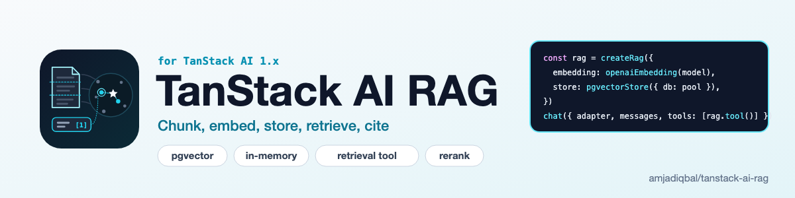

<p align="center">
  <picture>
    <source media="(prefers-color-scheme: dark)" srcset="art/banner-dark.png">
    
  </picture>
</p>

# TanStack AI RAG: retrieval-augmented generation with pgvector and citations

A small RAG kit for [TanStack AI](https://tanstack.com/ai), built on its public APIs: [`embed()`](https://tanstack.com/ai/latest/docs/embeddings), [`rerank()`](https://tanstack.com/ai/latest/docs/rerank/rerank) and [server tools](https://tanstack.com/ai/latest/docs/tools/server-tools). TanStack AI keeps vector storage in your app; this package adds the pieces around it: token-aware **Markdown and text chunking**, an **embed-and-store pipeline** that runs on TanStack AI's `embed()`, **pgvector (Postgres)** and **in-memory** vector stores, a **retrieval tool for `chat()`** whose results are numbered so answers can cite `[1]`, `[2]`, and an optional **`rerank()`** step.

Tested with `@tanstack/ai` 1.0.0, `@tanstack/ai-openai` (embeddings and chat), `@tanstack/ai-cohere` (rerank), and pgvector through `pg`, postgres.js, Drizzle (node-postgres) and PGlite. See [What is tested](#what-is-tested).

[](https://www.npmjs.com/package/@amjadiqbal/tanstack-ai-rag)
[](https://tanstack.com/ai)
[](LICENSE.md)

```ts
import { chat } from '@tanstack/ai'
import { openaiEmbedding, openaiText } from '@tanstack/ai-openai'
import { citationInstructions, createRag, pgvectorStore } from '@amjadiqbal/tanstack-ai-rag'

const rag = createRag({
  embedding: openaiEmbedding('text-embedding-3-small'),
  store: pgvectorStore({ db: pool, dimensions: 1536 }),
})

await rag.ingest([{ id: 'docs/install.md', title: 'Install guide', content: markdown, format: 'markdown' }])

const stream = chat({
  adapter: openaiText('gpt-4o-mini'),
  threadId,
  messages,
  systemPrompts: [citationInstructions],
  tools: [rag.tool()],
})
```

- **Chunking**: Markdown chunks never cross a heading, keep their heading path (`['Guide', 'Install']`) and keep fenced code blocks whole when they fit; long sections and plain text break at paragraphs, then lines, then sentences, then words. Sizes are in tokens; each chunk starts with up to `overlap` tokens from the end of the previous one. Pass your own tokenizer for exact counts.
- **Ingest**: chunks every document, embeds the chunks in batches with a TanStack AI embedding adapter through `embed()`, and stores them. Ingesting the same document id again replaces its chunks (in one transaction on pgvector).
- **Retrieve**: embeds the question, runs a cosine search with an optional metadata filter and minimum score, optionally reranks, and numbers the results for citation.
- **Tool**: `rag.tool()` is a TanStack AI server tool. The model calls it with a search query; it returns `{ query, results: [{ citation, id, source, url?, headings?, content, score }] }`, which your UI also receives as the tool call's output, so you can show the sources. Within one `chat()` run, citation numbers continue across searches, so two searches never both produce a `[1]`.
- No runtime dependencies besides the `@tanstack/ai` peer, and it imports only `embed`, `rerank` and `toolDefinition` from its main entry (no internal subpaths). The Postgres client is yours. No network calls of its own, no telemetry.

## Install

```bash
npm install @amjadiqbal/tanstack-ai-rag @tanstack/ai
```

Plus an embedding adapter (for example `@tanstack/ai-openai`) and, for Postgres, your driver (`pg`, `postgres`, or `@electric-sql/pglite` with `@electric-sql/pglite-pgvector`). Node 20 or newer, ESM only.

## 1. Pick a vector store

### Postgres with pgvector

```bash
docker run -d -e POSTGRES_PASSWORD=postgres -p 5432:5432 pgvector/pgvector:pg17
```

```ts
import pg from 'pg'
import { pgvectorStore } from '@amjadiqbal/tanstack-ai-rag'

const pool = new pg.Pool({ connectionString: process.env.DATABASE_URL })
export const store = pgvectorStore({ db: pool, table: 'rag_chunks', dimensions: 1536 })

await store.migrate() // CREATE EXTENSION vector, the table and its indexes, if missing
```

`db` takes any of these, and the package imports none of them:

| Client | Pass |
|---|---|
| `pg` Pool or Client | `pgvectorStore({ db: pool })` |
| postgres.js | `pgvectorStore({ db: sql })` where `sql = postgres(url)` |
| Drizzle | `pgvectorStore({ db })`; the store uses the driver client at `db.$client` (tested with `drizzle-orm/node-postgres`) |
| PGlite | `pgvectorStore({ db: new PGlite({ extensions: { vector } }) })` with `vector` from `@electric-sql/pglite-pgvector` |

`migrate()` creates this table (the name can be schema-qualified, like `kb.chunks`):

| Column | Type |
|---|---|
| `id` | `text` primary key (`<documentId>#<chunkIndex>`) |
| `document_id` | `text`, indexed |
| `content` | `text` |
| `metadata` | `jsonb`, GIN index (`jsonb_path_ops`) |
| `embedding` | `vector(dimensions)`, HNSW index with `vector_cosine_ops` |

HNSW needs pgvector 0.5+ and at most 2,000 dimensions. For bigger embeddings (`text-embedding-3-large` is 3,072) pass `index: 'none'` (exact search), ask the model for fewer `dimensions`, or create your own index. You can also skip `migrate()` and create the table yourself with the same column names.

### In memory

```ts
import { memoryVectorStore } from '@amjadiqbal/tanstack-ai-rag'

const store = memoryVectorStore() // exact cosine search, nothing persisted
```

Good for tests, demos and small corpora that you can rebuild on start.

### Your own database

A store is three methods. Implement `VectorStore` for anything else:

```ts
import type { VectorStore } from '@amjadiqbal/tanstack-ai-rag'

const myStore: VectorStore = {
  async upsert(records) {},                            // { id, documentId, content, metadata, vector }[]; replace by id
  async query({ vector, topK, filter }) { return [] }, // best first: { id, documentId, content, metadata, score }
  async deleteDocuments(documentIds) {},
  // optional: async replaceDocuments(documentIds, records) {} — delete + insert as one atomic step
}
```

`score` is cosine similarity (1 = same direction). Every key in `filter` must match. `filter` is typed for scalar values (string, number, boolean, `null`), and for those both built-in stores behave the same: the value must be equal and of the same type (`1` does not match `'1'`), and `null` matches a key stored as `null` but not a missing key. They differ if you cast an array or object into a filter: `memoryVectorStore` compares with `===`, so arrays and objects never match; `pgvectorStore` uses jsonb containment (`metadata @> filter`), so `{ tags: ['a'] }` matches a chunk tagged `['a', 'b']` and `{ owner: { id: 1 } }` matches an owner object that has more keys. `pgvectorStore` sends the filter as one bound JSON parameter, so keys and values are never spliced into SQL.

If your store implements `replaceDocuments`, `ingest()` uses it; otherwise it calls `deleteDocuments()` then `upsert()`, and a failure between the two loses the document's old chunks.

## 2. Ingest documents

```ts
import { openaiEmbedding } from '@tanstack/ai-openai'
import { createRag } from '@amjadiqbal/tanstack-ai-rag'

export const rag = createRag({
  embedding: openaiEmbedding('text-embedding-3-small'),
  store,
  chunking: { maxTokens: 512, overlap: 64 }, // the defaults
})

await rag.ingest([
  {
    id: 'docs/install.md',            // stable id; ingesting it again replaces its chunks
    title: 'Install guide',           // shown as the citation source (else url, else id)
    url: 'https://example.com/docs/install',
    content: installMarkdown,
    format: 'markdown',               // default 'text'
    metadata: { product: 'widgets' }, // stored on every chunk, usable in filters
  },
])
// -> { documents: 1, chunks: 2 }

await rag.remove('docs/install.md')
```

Each chunk is embedded together with its document title and heading path (`Install guide > Install > Configure`), which gives short chunks the context they lack; only the chunk text is stored and returned. The new chunks are embedded before the old ones are touched, so a failed embedding call leaves the previous version in place. Then the old chunks are swapped for the new ones:

- **pgvector**: delete and insert run in one transaction (all 500-row insert batches included), so a failed insert rolls back and the old chunks stay. It uses `sql.begin()` on postgres.js, `transaction()` on PGlite, and one checked-out connection on a `pg` Pool. On a single `pg` Client it sends `BEGIN`/`COMMIT` on that client, so don't share the client with other queries during an ingest.
- **memory**: the new records are copied first (the only step that can fail), then swapped in with no `await` in between, so a query sees either the old chunks or the new ones.

Every `ingest()` embeds every chunk again, even when the content hasn't changed; there's no content hashing. The heading line is part of a Markdown chunk's text (a chunk under `## Configure` starts with `## Configure`).

Models that want different input types for documents and queries (Cohere's `search_document` / `search_query`) get them through `documentModelOptions` and `queryModelOptions`. `dimensions` is passed to every `embed()` call; `batchSize` (default 64) sets how many chunks go into one call.

## 3. Let the model search: `rag.tool()` in `chat()`

A TanStack Start server route:

```ts
// src/routes/api/chat.ts
import { createFileRoute } from '@tanstack/react-router'
import { chat, chatParamsFromRequest, toServerSentEventsResponse } from '@tanstack/ai'
import { openaiText } from '@tanstack/ai-openai'
import { citationInstructions } from '@amjadiqbal/tanstack-ai-rag'
import { rag } from '../../server/rag'

export const Route = createFileRoute('/api/chat')({
  server: {
    handlers: {
      POST: async ({ request }) => {
        const { messages, threadId } = await chatParamsFromRequest(request)
        const stream = chat({
          adapter: openaiText('gpt-4o-mini'),
          threadId,
          messages,
          systemPrompts: [citationInstructions],
          tools: [rag.tool({ description: 'Search the Acme Widgets docs.' })],
        })
        return toServerSentEventsResponse(stream)
      },
    },
  },
})
```

`rag.tool()` options: `name` (default `search_knowledge_base`), `description` (say what the knowledge base holds; the model uses it to decide when to search), `topK`, `minScore`, a fixed `filter` applied to every search (a tenant or product id, for example), and `citations`. `citationInstructions` is a short system prompt that asks the model to cite results as `[n]` and to say so when the results don't contain the answer.

### Citation numbers

With `citations: 'run'` (the default), numbering is per `chat()` run: the first search's results are `[1]`, `[2]`, …; a later search in the same run gives new chunks the next numbers (`[3]`, `[4]`) and a chunk that was already returned keeps its number. Results stay in relevance order, so a later search can list `[4]` before `[2]`. The numbers are tracked per run through the run's abort signal, so they need nothing from you and are dropped with the run. Each new run (the next user message) starts at `[1]` again. With `citations: 'call'`, or when the tool runs outside `chat()`, every call starts at `[1]`. Every result also carries `id`, the chunk id, which is stable across calls and runs.

### Show the sources in React

The tool's output arrives on the assistant message as a `tool-call` part:

```tsx
import { fetchServerSentEvents, useChat } from '@tanstack/ai-react'
import type { RagToolOutput } from '@amjadiqbal/tanstack-ai-rag'

const { messages, sendMessage } = useChat({ threadId, connection: fetchServerSentEvents('/api/chat') })

{messages.map((m) =>
  m.parts.map((p, i) => {
    if (p.type === 'text') return <p key={i}>{p.content}</p>
    if (p.type === 'tool-call' && p.name === 'search_knowledge_base' && p.output) {
      const { results } = p.output as RagToolOutput
      return (
        <ol key={i}>
          {results.map((r) => (
            <li key={r.citation}>[{r.citation}] {r.url ? <a href={r.url}>{r.source}</a> : r.source}</li>
          ))}
        </ol>
      )
    }
    return null
  }),
)}
```

## 4. Or retrieve first and put the context in the prompt

When every question should be answered from the docs, skip the tool call and retrieve up front:

```ts
const results = await rag.retrieve(question, { topK: 4, filter: { product: 'widgets' } })

const stream = chat({
  adapter: openaiText('gpt-4o-mini'),
  threadId,
  messages,
  systemPrompts: [citationInstructions, rag.formatContext(results)],
})
```

`formatContext()` renders the results as numbered blocks (`[1] Install guide (Install > Configure)` followed by the chunk), matching the citation numbers on `results`. `retrieve()` numbers each call from `[1]`; the run-wide numbering above is the tool's.

`retrieve()` returns `RagResult[]`: everything the store returned (`id`, `documentId`, `content`, `metadata`, `score`) plus `citation`, `source`, `url`, `headings` and, with a reranker, `rerankScore`.

## 5. Optional rerank

Fetch more candidates by vector search, then let a reranker order them, with a TanStack AI rerank adapter:

```ts
import { cohereRerank } from '@tanstack/ai-cohere'

const rag = createRag({
  embedding,
  store,
  topK: 4,
  rerank: { adapter: cohereRerank('rerank-v3.5'), candidates: 20 }, // default candidates: topK * 4
})
```

The results come back in the reranker's order, each with `rerankScore`; the tool reports `rerankScore` as `score` when a reranker is set. `minScore` still applies to the vector score, before reranking. The reranker gets only the chunk text (no title or heading path). Inside `chat()`, the run's abort signal is passed to the rerank request; it is the only request that gets it, because TanStack AI's `embed()` and the store calls take no signal.

## Errors and edge cases

| Situation | What happens |
|---|---|
| `maxTokens` not a positive integer, or `overlap` not an integer from 0 to `maxTokens - 1` | `RangeError` from `chunkText` / `chunkMarkdown` / `ingest()` |
| `overlap` not set | `min(64, floor(maxTokens / 4))` |
| A document without `id`, or two documents with the same `id` in one `ingest()` call | `TypeError` (`every document needs an id`, `duplicate document id "<id>"`), nothing stored |
| `ingest([])` | Returns `{ documents: 0, chunks: 0 }` without calling the embedding adapter |
| A document whose content is empty or only whitespace | No chunks; its previous chunks are deleted (`chunks: 0`) |
| The embedding adapter returns a different number of vectors than inputs | `Error: embedding adapter returned <n> vectors for <m> inputs`, old chunks kept |
| Any error from the embedding adapter during `ingest()` | Rethrown, old chunks kept |
| An insert fails while `ingest()` replaces a document on pgvector (any batch) | The transaction rolls back, the error is rethrown, the old chunks stay |
| `batchSize` below 1 | Treated as 1 |
| `metadata` with keys `title`, `url`, `headings` or `chunkIndex` | Overwritten by the document's `title`/`url` and the chunk's own values |
| `topK: 0` | `[]` |
| Reranker configured but no vector match | `[]`, the reranker is not called |
| Tool called with an empty, blank or missing `query` | `{ query: '', results: [] }`, nothing embedded |
| Tool `score` | Rounded to 3 decimals (the rerank score when a reranker is set) |
| `memoryVectorStore`: vectors of different lengths | `RangeError: vector length mismatch: <a> vs <b>` on query; a zero vector scores 0 |
| `pgvectorStore`: a table name that isn't `name` or `schema.name` (letters, digits, `_`) | `TypeError` when the store is created |
| `pgvectorStore`: `db` is none of the supported clients | `TypeError` when the store is created |
| `pgvectorStore.migrate()` without `dimensions` | `TypeError`, nothing created |
| `pgvectorStore`: `NaN` or `Infinity` in a vector | `TypeError` before any SQL runs |
| `pgvectorStore`: a vector of the wrong size | Postgres's own error (`expected 3 dimensions, not 2`) |

## Scores and `minScore`

`score` is cosine similarity. What counts as a good score depends on the embedding model (scores from some models sit in a narrow band), so pick `minScore` by looking at your own results. Without `minScore`, `retrieve()` returns `topK` results whenever the store has that many, even weak ones; `citationInstructions` tells the model to say when the results don't answer the question.

## Chunking on its own

```ts
import { chunkMarkdown, chunkText } from '@amjadiqbal/tanstack-ai-rag'
import { getEncoding } from 'js-tiktoken'

const enc = getEncoding('cl100k_base')
const chunks = chunkMarkdown(markdown, { maxTokens: 400, overlap: 40, countTokens: (t) => enc.encode(t).length })
// [{ content, index, tokens, start, end, headings: ['Guide', 'Install'] }, ...]
```

`start` and `end` are character offsets into the source, so `source.slice(start, end) === content`. The default token counter, `estimateTokens`, assumes about 4 characters per token; pass a real tokenizer when chunks must fit a hard model limit. A heading with no text of its own (followed directly by a sub-heading, or the last line of the document) gives no chunk; when a sub-section follows, its title stays in that sub-section's heading path. The overlap is the longest end of the previous chunk that fits in `overlap` tokens, starting at a word boundary (at any character when the text has no spaces); it is smaller, or zero, when the next piece of text already takes up most of `maxTokens`. Chunks never overlap across a Markdown heading.

## API

| Export | What it is |
|---|---|
| `createRag(options)` | Returns `{ ingest, retrieve, formatContext, tool, remove, store }` |
| `pgvectorStore({ db, table?, dimensions?, index? })` | Postgres + pgvector store with `migrate()` |
| `memoryVectorStore()` | In-process store with `size` and `clear()` |
| `chunkText(text, options?)`, `chunkMarkdown(md, options?)` | Chunkers |
| `estimateTokens`, `cosineSimilarity` | Helpers |
| `citationInstructions` | System prompt text for cited answers |
| Types | `VectorStore`, `VectorRecord`, `VectorMatch`, `MetadataFilter`, `RagDocument`, `RagResult`, `RagToolOutput`, `Chunk`, `ChunkOptions`, ... |

`createRag` options: `embedding`, `store`, `chunking`, `dimensions`, `documentModelOptions`, `queryModelOptions`, `batchSize` (default 64), `topK` (default 5), `minScore`, `rerank`.

## What is tested

No live provider API was called and no API key was used. Provider traffic went to local mocks: [aimock](https://github.com/CopilotKit/aimock) for OpenAI chat and Cohere rerank, and a small local server for OpenAI's `/v1/embeddings` that returns bag-of-words vectors per input, so similarity is meaningful.

- **Unit tests** (vitest): chunk sizes with the estimator and with `js-tiktoken`, overlap, offsets, coverage, paragraph-first breaking, hard splits, Markdown heading paths, fenced code (backticks and tildes, `#` lines inside fences), overlap on long paragraphs (every neighbouring pair overlaps by at most `overlap` tokens, with the estimator and `js-tiktoken`), CRLF; `createRag` ingest, re-ingest, failed-embedding rollback, remove, filters, `minScore`, batching, model options, `formatContext`, rerank order, scores and abort signal, the tool's output, name, description, filter and empty query, citation numbering across calls in one run, and every row of [Errors and edge cases](#errors-and-edge-cases).
- **Store conformance** (the same checks for each): `memoryVectorStore`, and `pgvectorStore` on PGlite and on Postgres 17 + pgvector in Docker (`pgvector/pgvector:pg17`) through `pg`, postgres.js and Drizzle (`drizzle-orm/node-postgres`): nearest-first order, scores, metadata filters, nested JSON metadata, upsert-replace, delete by document, 1,200-row batches, `null` filters, number vs string filters, `replaceDocuments` (including a failure in the second 500-row batch that leaves the old chunks in place), idempotent `migrate()` and the HNSW index. Separately: array and object filters on both stores (`===` vs jsonb containment), a filter with SQL in its key and value returning nothing on PGlite, and a failed re-ingest through `createRag` on pgvector keeping the old chunks.
- **Integration** with real TanStack AI adapters over HTTP: `@tanstack/ai-openai` embeddings into PGlite and Docker Postgres; `chat()` with `openaiText` (Responses API) and `openaiChatCompletions` calling `rag.tool()` and answering with a citation; retrieved context passed through `systemPrompts`; `@tanstack/ai-cohere` rerank reordering results; two searches in one `chat()` run numbered `[1]`, `[2]`, then `[3]`.
- **In a real browser**: a TanStack Start 1.169 app with `@tanstack/ai-react` `useChat`, the server route above, Postgres + pgvector in Docker, and the packed npm tarball installed. Seen working: ingesting Markdown documents, search with heading paths and scores, the product filter, the `formatContext` block, a chat question that triggers the tool and shows numbered sources (with a link from `url`) and an answer citing `[1]`, follow-up turns on the same thread, a newly added document found by the next question, a removed document no longer returned, and rerank reordering the sources.
- **Not tested**: live embedding and chat APIs (so retrieval quality with real embeddings is not measured here), embedding adapters other than OpenAI's, hosted Postgres services, Drizzle on its postgres.js or PGlite drivers, and Vue, Solid or Svelte clients.

## Limits

- **No Pinecone, Upstash Vector or Qdrant adapters yet**: they could not be tested locally. Write a `VectorStore` (three methods, above), or open an issue.
- **Markdown**: ATX headings (`#`) only; setext headings (text underlined with `===` or `---`) and headings inside HTML blocks are treated as text.
- **Re-ingest is atomic only in stores with `replaceDocuments`** (both built-in stores have it). Unchanged content is still embedded again.
- TanStack AI's `embed()` has no abort signal, so the embedding step of a search, and the store query, cannot be cancelled; only rerank can.
- Filters are equality on scalar metadata values (see above for arrays and objects). For ranges or `IN`, filter in your own store or query.
- The default token count is an estimate (about 4 characters per token).

## Support

- 🐛 **Bug or feature request**: [open an issue](https://github.com/amjadiqbal/tanstack-ai-rag/issues)
- 🔒 **Security issue**: please report privately via GitHub's security tab

## Need this built into your app, or something custom?

[Get in touch](https://amjad.com.pk/contact?utm_source=github&utm_medium=readme&utm_campaign=tanstack-ai-rag).

[](https://www.upwork.com/freelancers/amjadkhatri)

## More packages

Part of a family of open-source packages. See [all of them](https://github.com/amjadiqbal?tab=repositories).

| | |
|---|---|
| [tanstack-ai-sdk-bridge](https://github.com/amjadiqbal/tanstack-ai-sdk-bridge) | Use any Vercel AI SDK provider as a TanStack AI adapter |
| [query-key-kit](https://github.com/amjadiqbal/query-key-kit) | Typed query-key hierarchy and invalidation helpers for TanStack Query v5 |
| [start-seo-kit](https://github.com/amjadiqbal/start-seo-kit) | SEO for TanStack Start: meta tags, sitemaps, JSON-LD |
| [tanstack-table-url-state](https://github.com/amjadiqbal/tanstack-table-url-state) | URL state and CSV/XLSX export for TanStack Table |

## License

MIT. See [LICENSE.md](LICENSE.md). Not affiliated with TanStack; product names are used only to say what this package works with.
